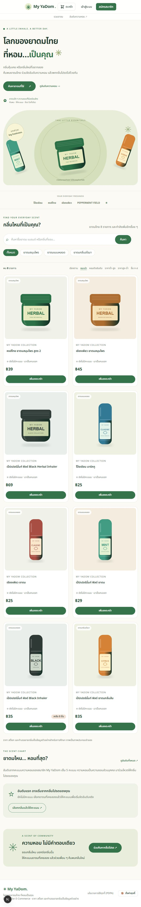

# My YaDom — รวมยาดมไทย จัดอันดับกลิ่นที่คุณรัก

โปรเจกต์วิชา E-Commerce พัฒนาต่อจาก VitaShop ใน repository เดิม
เปลี่ยนแนวคิดจากวิตามินและอาหารเสริมเป็นแคตตาล็อกยาดมไทย พร้อมรีวิว จัดอันดับความหอม และสั่งซื้อสินค้า



## ความต่อเนื่องของงาน

ประวัติ Git สัปดาห์ 1–4 ยังคงอยู่ทั้งหมด การเปลี่ยนเป็น My YaDom เป็น commit ใหม่ต่อจากงานเดิม

| ช่วงงาน | สิ่งที่พัฒนา |
|---|---|
| Week 1 · 6f03603 | แคตตาล็อก ค้นหา หมวดหมู่ รายละเอียดสินค้า |
| Week 2 · 50c2b8b | สมาชิก ตะกร้า เช็กเอาต์ และประวัติคำสั่งซื้อ |
| Week 3 · aede353 | หลังบ้าน สต็อก และจัดการคำสั่งซื้อ |
| Week 4 · bc77091 | แดชบอร์ด คุกกี้ PDPA และบันทึกความยินยอม |
| My YaDom | เปลี่ยนแบรนด์และหน้าตา แคตตาล็อกยาดม รีวิว และอันดับความหอม |

My YaDom ใช้ระบบสมาชิก ตะกร้า สั่งซื้อ สต็อก และหลังบ้านที่พัฒนามาก่อนแล้วต่อไป
เก็บชื่อคุกกี้และบัญชีทดสอบเดิมเพื่อให้เซสชันและข้อมูลเดิมใช้งานต่อได้

## เริ่มใช้งาน

Node.js 20.9 ขึ้นไป และ npm

**ถ้ามีฐานข้อมูล VitaShop เดิมแล้ว** ให้ใช้ migration เพื่อรักษาข้อมูล:

```bash
npm install
npm run db:migrate:yadom
npm run dev
```

migration สำรองฐานข้อมูลรวมข้อมูลใน WAL เป็นไฟล์
`data/shop.db.before-yadom-<timestamp>.bak` ก่อนเปลี่ยนข้อมูล
ปิดการขายสินค้าเดิมด้วย `is_active = 0` โดยไม่ลบสินค้า บัญชี ที่อยู่ คำสั่งซื้อ หรือรายการสินค้าในออเดอร์เดิม
เพิ่มยาดม 8 รายการและตารางรีวิว การรันซ้ำไม่เพิ่มสินค้าซ้ำ

**ถ้าติดตั้งใหม่และไม่มีข้อมูลที่ต้องเก็บ:**

```bash
npm install
npm run db:seed
npm run dev
```

เปิด [My YaDom ในเครื่อง](http://localhost:3000)

**ข้อควรระวัง:** `npm run db:seed` ลบข้อมูลในฐานข้อมูลเป้าหมายและสร้างใหม่ ใช้เฉพาะการติดตั้งใหม่หรือรีเซ็ตข้อมูลทดสอบ
กำหนดตำแหน่งฐานข้อมูลได้ด้วย `DATABASE_PATH` ทั้งใน seed, migration และแอป
ฐานข้อมูลและไฟล์สำรองอยู่ใน `data/` ที่ Git ignore จึงไม่ส่งข้อมูลสมาชิกขึ้น GitHub

## ฟีเจอร์

- หน้าแรกและภาพประกอบยาดมในโทนเขียวครีม รองรับมือถือ
- ค้นหาชื่อ แบรนด์ และคำอธิบาย กรองหมวดสมุนไพร แบบหลอด และอโรมา
- เรียงตามราคา ชื่อ หรือคะแนนความหอม แชร์ผลการค้นหาผ่าน URL ได้
- สมาชิกให้คะแนนความหอม 1–5 พร้อมข้อความรีวิวไม่เกิน 500 ตัวอักษร
- 1 บัญชีมีคะแนนต่อสินค้าได้ 1 รายการ แก้ไขคะแนนได้โดยไม่เพิ่มจำนวนโหวต
- หน้าอันดับและ Top 3 หน้าแรกคำนวณจากค่าเฉลี่ยจริง ถ้าเสมอกันใช้จำนวนคะแนน แล้วใช้รหัสสินค้า
- สินค้าไม่มีคะแนนจะยังไม่เข้าอันดับ ไม่เติมคะแนนหรือรีวิวปลอมให้ดูเป็นผู้ใช้จริง
- รีวิวแสดงล่าสุดสูงสุด 50 รายการ แต่ค่าเฉลี่ยและจำนวนคะแนนนับจากทั้งหมด
- สมาชิกทั่วไปรีวิวได้ ยังไม่มีการยืนยันว่าซื้อสินค้าจริง
- เพิ่มลงตะกร้า เลือกจำนวน เช็กเอาต์ และดูประวัติคำสั่งซื้อ
- หลังบ้านเพิ่ม/แก้ไขสินค้า รูป ราคา สต็อก และจัดการคำสั่งซื้อ
- ระบบความยินยอมคุกกี้และนโยบายคุกกี้จาก Week 4

## ขอบเขตข้อมูลสำหรับการศึกษา

เป้าหมายระยะต่อไปคือรวบรวมยาดมทุกแบรนด์ในไทย รุ่นนี้เริ่มต้น 8 รายการจาก 4 แบรนด์
จึงยังไม่อ้างว่าครบทุกชนิดในประเทศไทย เพิ่มแบรนด์และรุ่นต่อผ่านหลังบ้านได้

ชื่อสินค้าอ้างอิงแบรนด์จริง ส่วนราคา สต็อก และคำบรรยายกลิ่นเป็นข้อมูลตัวอย่างสำหรับการเรียน
ภาพ SVG เป็นภาพประกอบที่สร้างขึ้นเอง ไม่ใช่ภาพบรรจุภัณฑ์จริงหรือหลักฐานรับรองจากแบรนด์
คะแนนความหอมเป็นความชอบส่วนบุคคลของสมาชิก

แหล่งอ้างอิงชื่อแบรนด์และรุ่น:

- [โป๊ยเซียน — เว็บไซต์ผู้ผลิต](https://www.poysian.co.th/en/)
- [หงส์ไทย — เว็บไซต์แบรนด์](https://hongthaiherb.com/)
- [Peppermint Field — เว็บไซต์ผู้ผลิต](https://bertram1958.com/เป๊ปเปอร์มิ้นท์-ฟิลด์/)
- [เซียงเพียว — ข้อมูลชื่อยาดมจาก อย.](https://ndi.fda.moph.go.th/drug_detail/index/?rcno=4500059&rctype=2A&register=MkEgNTkvNDU%3D)

ระบบสั่งซื้อเป็นตัวอย่างในรายวิชา มีตัวเลือกเก็บเงินปลายทาง/โอนเงินจากงานเดิม
ยังไม่ได้เชื่อม payment gateway หรือบริษัทขนส่งจริง

## บัญชีทดสอบจาก seed

| สิทธิ์ | อีเมล | รหัสผ่าน |
|---|---|---|
| ผู้ดูแล | admin@vitashop.com | 123456 |
| ลูกค้า | customer@vitashop.com | 123456 |

migration ไม่เปลี่ยนรหัสผ่านหรือบัญชีเดิม หากเคยเปลี่ยนข้อมูลแล้วให้ใช้บัญชีเดิมของคุณ

## ตรวจสอบงาน

```bash
npm run lint
npm run build
npm run test:yadom
```

`test:yadom` ใช้ฐานข้อมูลชั่วคราวแยกจากข้อมูลจริง ตรวจ migration การเก็บออเดอร์เก่า
การรันซ้ำ สำรองข้อมูล ขอบเขตคะแนน และข้อจำกัดหนึ่งคะแนนต่อบัญชี
เมื่อเปิดเว็บแล้วรัน `npm run check:cookies` เพื่อตรวจหน้าแคตตาล็อก อันดับ และรายละเอียดสินค้า

## เทคโนโลยีและไฟล์สำคัญ

Next.js 16 App Router · TypeScript · Tailwind CSS 4 · SQLite / better-sqlite3
ฟอนต์ Noto Sans Thai และภาพ SVG อยู่ในโปรเจกต์ ไม่ต้องเรียกบริการฟอนต์หรือรูปภายนอก

| ไฟล์ | หน้าที่ |
|---|---|
| `db/yadom-catalog.mjs` | ข้อมูลแคตตาล็อกเริ่มต้น ใช้ร่วมกับ seed และ migration |
| `db/migrate-yadom.mjs` | ย้ายข้อมูลจาก VitaShop พร้อมสำรองฐานข้อมูล |
| `db/reviews.sql` | โครงสร้างตารางและข้อจำกัดรีวิว |
| `src/lib/products.ts` | ค้นหา กรอง เรียง และรวมคะแนนจากฐานข้อมูล |
| `src/app/actions/reviews.ts` | ตรวจตัวตนและบันทึก/แก้ไขคะแนน |
| `src/app/rankings/page.tsx` | หน้าอันดับความหอม |
| `src/components/RankingSection.tsx` | แสดงอันดับและสถานะยังไม่มีคะแนน |
| `public/products/` | ภาพประกอบยาดม SVG |
